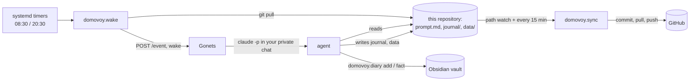

# Domovoy

Domovoy is a small proactive personal assistant built on top of
[Claude Code](https://docs.claude.com/en/docs/claude-code/overview) and the
Telegram bridge [Gonets](https://github.com/ivbala1/gonets). Twice a day it
wakes an agent in your private Telegram chat: in the morning it proposes a
plan for the day, in the evening it checks the plan and asks one question about
your day. Its rules are a Markdown file you edit, its memory is a journal in
git, and it keeps your diary in Obsidian.

*Domovoy* (домовой) is the house spirit of Slavic folklore: an invisible helper
who keeps the household in order and grumbles when you neglect it.

> **Status.** This is a personal project, published as is. It runs daily for its
> author. Issues and discussions are read, but no response or support is
> promised. Code comments are in Russian; messages, prompts and templates are
> English by default (`DOMOVOY_LANG=ru` switches them to Russian).

## The idea

There is almost no logic in the code. Timers only wake the agent and say what
time of day it is; *what* is useful right now (a plan, one question, a
reminder, a weekly review, or silence) is decided by the agent from your rules,
the journal, your calendar and your messages. You change the assistant's
behaviour by editing `prompt.md`, not code. Your `prompt.md`, `diary.md`,
`journal/` and `data/` are your data: the sync job commits them to your
private remote, and upstream never touches them.

What the code does take care of is what a model is bad at:

- **Delivery.** Wake-ups are sent to Gonets as `POST /event`, retried while the
  bot restarts, and dropped if they would arrive too late (a morning plan at
  3 p.m. is useless). Morning runs are silent; the evening one rings.
- **Safe storage.** The journal and your tables live in git. A sync job commits
  only data, pulls, pushes, and stops on a conflict instead of guessing: it
  tells you once and waits. Files with conflict markers are never committed.
- **The diary.** Entries are appended to a day file in your Obsidian vault by
  commands, never rewritten; a repeated entry is not duplicated; edits that
  arrive from your phone between read and write are detected; every write is
  committed to a local git repository of the vault.
- **Context from other sessions.** `domovoy.diary sessions` extracts what you
  said to agents in other Claude Code sessions that day, so decisions made at
  the desk reach the diary. (The author's copy refuses to do this from client
  work, using his memory router; `DOMOVOY_CLIENT_BOUNDARY=off` in the example
  `.env` turns that check off.)
- **Photos.** An optional job adds a grid of the day's photos from a
  self-hosted [Immich](https://immich.app/) server to the diary.

## How it works



The agent runs in the same Claude session as your private chat with the bot,
so your replies continue the conversation. Gonets marks the chat with a scope
note that points to `prompt.md`.

## Requirements

- A running [Gonets](https://github.com/ivbala1/gonets) bot (same machine).
- Linux with systemd user services, Python 3.12 or newer.
- A private git repository for your copy (the journal is personal).
- Optional: an Obsidian vault for the diary, an Immich server for photos.

## Install

```bash
git clone https://github.com/ivbala1/domovoy-agent.git ~/domovoy
cd ~/domovoy
./install.sh             # venv, dependencies, .env from the example, stops
$EDITOR .env             # DOMOVOY_CHAT_ID, DOMOVOY_VAULT_DIR
./install.sh             # again: prompt.md and diary.md from the examples, systemd units
```

Then point the repository at your own **private** remote
(`git remote set-url origin git@github.com:you/my-domovoy.git`): the sync job
pushes your journal there.

In Telegram, in your private chat with Gonets, give the chat its rules once:

```
/scope This is Domovoy, my personal assistant. Follow ~/domovoy/prompt.md; the journal is in ~/domovoy/journal.
```

Wake-ups are background runs: Gonets cannot show approval cards there. Let the
agent write its own files without a card by adding them to
`APPROVE_WHITELIST_PATHS` in Gonets' `.env`, for example
`/home/you/domovoy/journal:/home/you/domovoy/data:/home/you/Obsidian/Diary`.
Calls of `domovoy.diary` are shell commands; add a narrow pattern for them to
`APPROVE_BASH_AUTO_ALLOW_REGEX`, or accept the trade-off of
`APPROVE_AUTO_CHAT_KEYS` for this chat.

Try a wake-up without waiting for the timer:

```bash
.venv/bin/python -m domovoy.wake --morning --dry-run --force   # print the event
.venv/bin/python -m domovoy.wake --morning --force             # send it
```

## Files

| File | What it is |
|---|---|
| `prompt.md` | the assistant's rules: role, what to do on each wake-up, boundaries, journal format. `install.sh` copies it from `prompt.example.md`; make it yours. |
| `diary.md` | rules for the diary (from `diary.example.md`): what goes there and how to retell |
| `journal/YYYY-MM.md` | the assistant's journal, one file per month |
| `data/` | your tables (whatever the rules mention) |
| `domovoy/wake.py` | wake-ups (`--morning`, `--evening`, `--midday`, `--search`) |
| `domovoy/sync.py` | git sync of data with conflict handling |
| `domovoy/diary.py` | diary commands: `add`, `fact`, `mark`, `rollup`, `status`, `feed`, `commit`, `sessions` |
| `domovoy/sessions.py` | what you said in other Claude Code sessions today |
| `domovoy/immich/` | photos of the day into the diary |
| `systemd/` | unit templates rendered by `install.sh` |

## Not in this release

The author's own copy also has an hourly *watcher*: code reads new mail and
Telegram messages, a cheap classifier decides whether anything needs attention,
and only then wakes the agent with a summary in a read-only run. It is tied to
private sources and is not published yet.

## Development

```bash
.venv/bin/python -m pytest -q
.venv/bin/python tools/i18n_catalog.py check
```

Messages are written in Russian in the code and wrapped in `_()`; the English
text lives in `domovoy/locales/en.json`.

## License

MIT, see [LICENSE](LICENSE).
